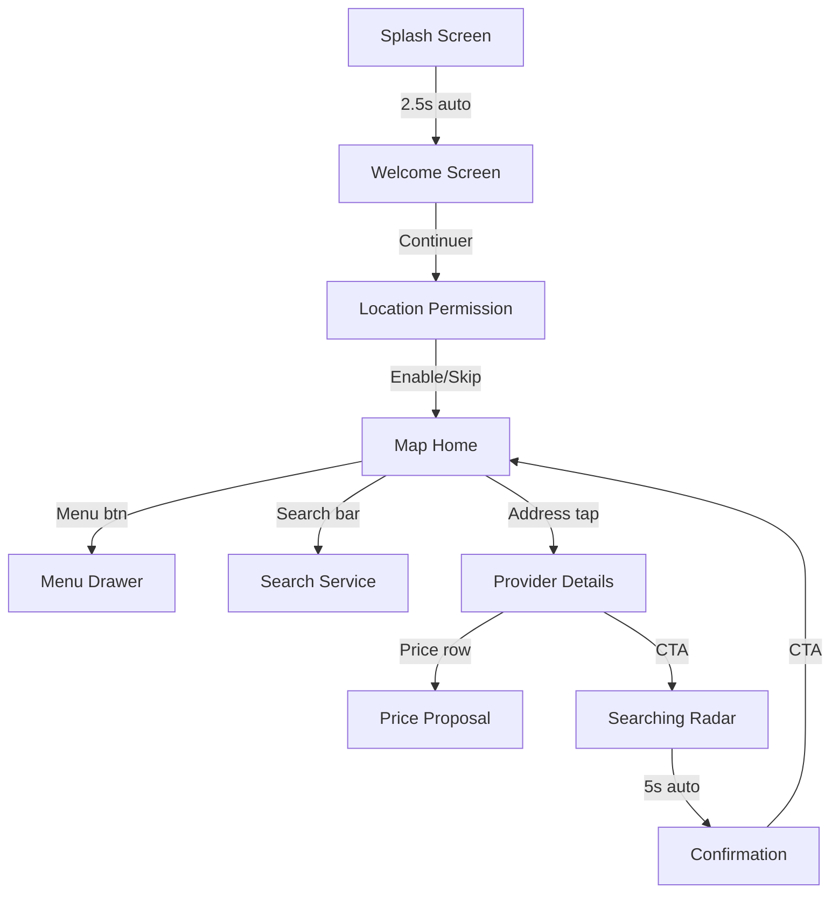

# InHome Mobile App — Stitch Design Implementation

## Summary

Successfully translated all UI/UX designs from the [Google Stitch project](https://stitch.withgoogle.com/projects/6202642527313388330) into production-ready React Native (Expo) source code using pure JavaScript (ES Modules).

## Design Tokens Extracted

The complete Material 3-inspired dark theme palette was extracted directly from the Stitch project's Tailwind config:

| Token | Hex | Usage |
|-------|-----|-------|
| `accent` | `#EB431C` | Primary CTA buttons (tomato red) |
| `secondaryContainer` | `#CB2C02` | Button fills, accent elements |
| `background` | `#131313` | Screen backgrounds |
| `primaryContainer` | `#121212` | Splash/onboarding backgrounds |
| `surfaceContainer` | `#1F2020` | Cards, elevated surfaces |
| `surfaceContainerHigh` | `#2A2A2A` | Higher-elevation surfaces |
| `onSurface` | `#E4E2E1` | Primary text |
| `onSurfaceVariant` | `#C4C7C7` | Secondary text |
| `outlineVariant` | `#444748` | Borders, dividers |

## Files Generated

### Theme
- [`colors.js`](file:///c:/Users/Owner/Desktop/GithubPrj/InHome----APP/inhome-mobile/src/theme/colors.js) — Complete design token export

### Reusable Components (7 files)
- [`PrimaryButton.js`](file:///c:/Users/Owner/Desktop/GithubPrj/InHome----APP/inhome-mobile/src/components/UI/PrimaryButton.js) — Tomato CTA with filled/outline/ghost variants + press scale animation
- [`CustomKeypad.js`](file:///c:/Users/Owner/Desktop/GithubPrj/InHome----APP/inhome-mobile/src/components/UI/CustomKeypad.js) — 3×4 numeric grid with backspace/globe icons
- [`BottomSheetContainer.js`](file:///c:/Users/Owner/Desktop/GithubPrj/InHome----APP/inhome-mobile/src/components/UI/BottomSheetContainer.js) — Draggable sheet with snap points + swipe dismiss
- [`ProviderMarker.js`](file:///c:/Users/Owner/Desktop/GithubPrj/InHome----APP/inhome-mobile/src/components/Map/ProviderMarker.js) — Map pin with active/inactive states
- [`RadarAnimation.js`](file:///c:/Users/Owner/Desktop/GithubPrj/InHome----APP/inhome-mobile/src/components/Map/RadarAnimation.js) — 3-ring pulse animation with staggered delays
- [`ServiceCategoryItem.js`](file:///c:/Users/Owner/Desktop/GithubPrj/InHome----APP/inhome-mobile/src/components/Cards/ServiceCategoryItem.js) — Pill toggle with accent border selection
- [`ProviderInfoCard.js`](file:///c:/Users/Owner/Desktop/GithubPrj/InHome----APP/inhome-mobile/src/components/Cards/ProviderInfoCard.js) — Glassmorphism card with address/job rows

### Onboarding Screens (3 files)
- [`SplashScreen.js`](file:///c:/Users/Owner/Desktop/GithubPrj/InHome----APP/inhome-mobile/src/screens/onboarding/SplashScreen.js) — Logo + wordmark + fade-in animation → auto-nav 2.5s
- [`WelcomeScreen.js`](file:///c:/Users/Owner/Desktop/GithubPrj/InHome----APP/inhome-mobile/src/screens/onboarding/WelcomeScreen.js) — Script headline + pagination dots + Continuer CTA
- [`LocationPermissionScreen.js`](file:///c:/Users/Owner/Desktop/GithubPrj/InHome----APP/inhome-mobile/src/screens/onboarding/LocationPermissionScreen.js) — Illustration + headline + primary/ghost CTAs

### Main Screens (3 files)
- [`MapHomeScreen.js`](file:///c:/Users/Owner/Desktop/GithubPrj/InHome----APP/inhome-mobile/src/screens/main/MapHomeScreen.js) — Dark map + menu button + search bar + categories + recent addresses
- [`SearchServiceScreen.js`](file:///c:/Users/Owner/Desktop/GithubPrj/InHome----APP/inhome-mobile/src/screens/main/SearchServiceScreen.js) — Full-screen search with filterable suggestions
- [`MenuDrawerScreen.js`](file:///c:/Users/Owner/Desktop/GithubPrj/InHome----APP/inhome-mobile/src/screens/main/MenuDrawerScreen.js) — 80% drawer with profile, menu items, CTA, social icons

### Booking Flow Screens (4 files)
- [`ProviderDetailsScreen.js`](file:///c:/Users/Owner/Desktop/GithubPrj/InHome----APP/inhome-mobile/src/screens/booking/ProviderDetailsScreen.js) — Map + bottom sheet with action rows + CTA
- [`PriceProposalScreen.js`](file:///c:/Users/Owner/Desktop/GithubPrj/InHome----APP/inhome-mobile/src/screens/booking/PriceProposalScreen.js) — Price input with blinking cursor + keypad + pill toggles + material switch
- [`SearchingRadarScreen.js`](file:///c:/Users/Owner/Desktop/GithubPrj/InHome----APP/inhome-mobile/src/screens/booking/SearchingRadarScreen.js) — Radar pulse + scattered markers + progress bar → auto-nav 5s
- [`ConfirmationScreen.js`](file:///c:/Users/Owner/Desktop/GithubPrj/InHome----APP/inhome-mobile/src/screens/booking/ConfirmationScreen.js) — Map pins + info card + 3 selectable quote tiers + CTA

### Navigation
- [`AppNavigator.js`](file:///c:/Users/Owner/Desktop/GithubPrj/InHome----APP/inhome-mobile/src/navigation/AppNavigator.js) — Full stack navigator with screen-specific transition animations

## Navigation Flow



## Dependencies Installed

```
@react-navigation/drawer
react-native-gesture-handler
react-native-reanimated
react-native-screens
react-native-safe-area-context
@react-native-masked-view/masked-view
react-native-maps
expo-location
expo-linear-gradient
lucide-react-native
react-native-svg
@gorhom/bottom-sheet
```

## How to Run

```bash
cd inhome-mobile
npx expo start
```

> [!TIP]
> All screens use `StyleSheet.create` with exact hex codes from Stitch. The `lucide-react-native` icons map to the Material Symbols icons used in the Stitch designs.
